# Конвейер

```mermaid
flowchart LR
  A[Исходники<br/>камера, экран, микрофон<br/>только чтение] --> B[Синхронизация<br/>find_offset / sync_pieces]
  B --> C[Расшифровка<br/>whisper.cpp локально]
  C --> D[Выбор дублей по тексту<br/>kit-rough-cut]
  D --> E[EDL<br/>данные с причинами]
  E --> F[edl_timeline.py<br/>таймлайн + флаги планов]
  F --> G[Звук<br/>voice_master / mix_bed]
  F --> H[Remotion<br/>лицо, ScreenCam, вставки, субтитры]
  G --> H
  H --> I[Черновик 720p]
  I --> J[QC<br/>editorial_qc, ghost_frames,<br/>cut_strips, clip_check]
  J --> K{{Человек смотрит<br/>и пишет замечания}}
  K -- исправить все --> E
  K -- принято --> L[Финал 1440p/4K<br/>мастер -15 LUFS]
  L --> M[Финальный QC + .srt<br/>exports/]
```



## Кто что делает
| Шаг | Инструмент | Кто решает |
|---|---|---|
| Синхронизация, расшифровка, замеры | скрипты (FFmpeg, whisper.cpp, Python) | машина |
| Выбор дубля по тексту, паузы, EDL | агент со скиллом `kit-rough-cut` | агент предлагает, человек утверждает |
| Звук | `voice_master.py`, `mix_bed.py` | цифры - машина, тембр - ухо человека |
| Графика и сборка | Remotion (`src/kit/`) + официальные скиллы `remotion-*` | агент |
| Проверка | `kit-qc` и скрипты `scripts/qc/` | машина ищет, человек решает «намеренно или дефект» |
| Вкус, эмоция, финальное ухо | - | **только человек** (`docs/LIMITS.md`) |

## Папки проекта
```
footage/<дата>/        исходники (только чтение, не в Git)
work/<ролик>/          всё промежуточное: расшифровки, стемы, отчёты QC
public/<ролик>/media/  обработанные куски для Remotion: <id>_face.mp4, <id>_screen.mp4, <id>_voice.wav
projects/<ролик>/      EDL и композиция ролика
exports/<ролик>/       готовое: MP4, .srt, QC-отчёт
```
